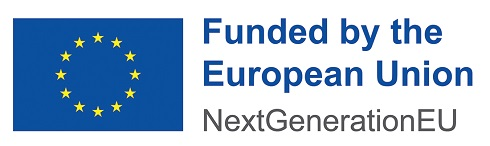

<!--
  DRAFT. The top half of this file is the FIN-CLARIAH deliverable report, in the
  shape of the 2025 D3.3.3 README (fields from the coordinators' template).
  The description (max. 3000 characters) is also emailed as a Word document.
  Open items are marked TODO.
-->

# D3.3.3 (a) Analysis tools for providing metadata for web data: language, country and register

**Project:** [FIN-CLARIAH](https://www.kielipankki.fi/organization/fin-clariah/)  
**Grant agreement:** Research Council of Finland no. 358720  
**Start date:** TODO (the 2025 template says 01-01-2024; check the current phase)  
**Duration:** TODO

**W3.3:** Report on analysis tools for providing metadata for web data: language, country and register  
**Date of reporting:** TODO (due 02-11-2026)

**Report authors:** TODO  
**Contributors:** TODO  
**Deliverable location:**

* Code repository: TODO (this repository)
* Demonstration: TODO (Colab link to `notebooks/webmeta_demo.ipynb`)
* Demo data: TODO (multilingual HPLT 4 sample on Hugging Face)

**Keywords:** web data; metadata; language identification; country; web registers; HPLT

**Description**

<!-- TODO: draft text, not yet reviewed. Keep within 3000 characters. -->

Web-crawled datasets are among the largest text resources available to SSH research, but they are noisy and carry little metadata, which makes it hard to find the material a research question needs.

*webmeta* turns a large web corpus into research datasets. It reads corpus metadata (register labels, language, country) and lets a researcher describe the subsample they want: which documents qualify, how to stratify, how large a subsample. The package then produces that subsample reproducibly. This makes each study just a set of settings for the tool, so a single corpus can serve many research projects without new code.

* **Language:** documents are selected by their main language, and multilingual documents can be targeted using segment-level language identification.
* **Country:** a country signal is derived from the document's top-level domain, so that, for example, Swedish written in Finland can be separated from Swedish written in Sweden.
* **Register:** documents are selected by the 25-class web register taxonomy of Skantsi and Laippala (2023), including hybrid documents that combine registers.

The repository is a Python package, `webmeta`, used in three ways. On LUMI, it runs from the command line as batch jobs over large corpus samples. The Colab demo notebook in the repo can be used standalone, where the package is installed straight from the repository and runs end to end on a small demo dataset. The package can also be imported by a researcher's own study code. It reads two kinds of input: validated HPLT 4 samples drawn by TurkuNLP's HPLT sampler, or a user's own corpus in CSV or JSONL, with its fields mapped onto field names used by the package. HPLT 4 documents already carry language identification and register probabilities for 92 languages. This README doubles as the report for Fin-CLARIAH deliverable D3.3.3 (a).

TODO: references; links; events (FIN-CLARIAH meeting poster, 9 Nov 2026).

*FIN-CLARIAH project has received funding from the European Union – NextGenerationEU instrument and is funded by the Research Council of Finland under grant number 358720.*



---

## Using webmeta

### In Colab
Open [`notebooks/webmeta_demo.ipynb`](notebooks/webmeta_demo.ipynb) in Colab (TODO: badge) and run all cells.

### In Python
```bash
pip install "webmeta[zst] @ git+https://github.com/TurkuNLP/web-metadata-fin-clariah"   # TODO: final URL
```
```python
import webmeta

docs = webmeta.read("shard.jsonl.zst")                 # HPLT 4 file
for doc in webmeta.run(docs, adapter="hplt4", lang="swe", country="FI", register="NA"):
    print(doc["meta"])   # {'lang': 'swe', 'country': 'FI', 'registers': ['NA', 'nb'], ...}
```

### On the command line
```bash
webmeta check shard.jsonl.zst                          # which steps the data supports
webmeta run shard.jsonl.zst -o out.jsonl --lang swe --country FI --register NA
```
On LUMI, webmeta runs on validated samples published by `hplt-sampler`, not on raw shards; see [`lumi/`](lumi/).

### Filters
| Option | Meaning |
|---|---|
| `lang` | language codes; `fi`, `fin` and `fin_Latn` are equivalent |
| `any_segment` | match `lang` in any part of the document, not only its main language |
| `multilingual` | `True`: only documents with two or more segment languages |
| `country` | ISO 3166-1 codes from the top-level domain; generic domains give no country |
| `register` | register labels; a document matches if it has any of them |
| `hybrid` | `True`: only documents with two or more main registers |
| `exclude` | register labels that disqualify a document, e.g. `("MT",)`; default none |
| `threshold` | register probability needed for a label; default: the register model's per-language value (English 0.40, Finnish 0.45, …) |

Every kept document gets a `meta` field with what webmeta derived; source fields are left untouched.

## Your own corpus: the record contract

webmeta works on any corpus whose records provide these fields. HPLT 4 records are converted automatically (`adapter="hplt4"`); for other data, map your field names with `webmeta.from_mapping(record, {"text": "body", "url": "link", ...})`.

| Field | Type | Needed for |
|---|---|---|
| `text` | string | always |
| `url` | string | country |
| `lang` | language code | language |
| `seg_langs` | list of language codes | multilingual documents |
| `register` | `{label: probability}`, or one column per label | register |

A missing field only disables the step that needs it. `webmeta.coverage(records)` reports how many records each step can use. The full contract is in [`src/webmeta/schema.py`](src/webmeta/schema.py).

## Development
```bash
python -m venv .venv && .venv/bin/pip install -e ".[all,dev]"
.venv/bin/pytest
```
The test fixtures are synthetic; see [`tests/fixtures/README.md`](tests/fixtures/README.md).
