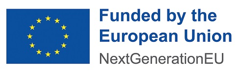

# D3.3.3 (a): Analysis tools for providing metadata for web data: language, country and register

[](https://colab.research.google.com/github/TurkuNLP/web-metadata-fin-clariah/blob/main/notebooks/webmeta_demo.ipynb)

**Project:** [FIN-CLARIAH](https://www.kielipankki.fi/organization/fin-clariah/)  
**Grant agreement:** Research Council of Finland no. 367751  
**Start date:** 01-01-2026  
**Duration:** 24 months

**WP 3.3:** Report on analysis tools for providing metadata for web data: language, country and register  
**Date of reporting:** 02-11-2026

**Report authors:** Tuomas Lundberg, Erik Henriksson, Tuukka Törö, Veronika Laippala (TurkuNLP, University of Turku)  
**Contributors:** –  
**Deliverable location:**

* Code repository: https://github.com/TurkuNLP/web-metadata-fin-clariah
* Demonstration: [Google Colab notebook](https://colab.research.google.com/github/TurkuNLP/web-metadata-fin-clariah/blob/main/notebooks/webmeta_demo.ipynb)
* Demo data: Finnish and Swedish HPLT 4.0 sample, https://huggingface.co/datasets/TurkuNLP/webmeta-demo-fi-sv

**Keywords for the deliverable page:** web data; metadata; language identification; multilingual documents; country; web registers; HPLT; SSH research

**Description**

Web-crawled corpora are among the largest text resources for research in the social sciences and humanities (SSH). For example, the newest HPLT version, HPLT 4.0, was built from over 10 petabytes of web archives, and its cleaned release holds 18.8 billion documents in 194 languages. When dealing with a corpus of these proportions, it’s hard to find the material a research question needs.

In this deliverable we publish **webmeta**, an open-source Python package that turns a large web corpus into research datasets. A researcher describes the subsample they need by its metadata: how many to draw, which documents qualify, and how to stratify. Webmeta then builds that subsample reproducibly, essentially reducing each study dataset to a set of settings. This enables a single corpus to serve many projects without writing new sampling and filtering code each time.

* **Language.** The main language of each document and the languages of its segments, so multilingual documents can be selected or excluded.
* **Register.** 25 web registers, such as news reports, recipes and opinion blogs, from a multilabel classifier with per-language thresholds. Documents that mix registers, as most web documents do (Henriksson et al. 2026b), can be selected as hybrids.
* **Country.** A country and UN region from the document’s web address. This is a proxy: where a domain such as .fi points to a country, generic domains such as .com have no such information, and furthermore, some country codes are sold and used worldwide.

HPLT 4.0 carries language identification and, for 92 languages, register labels from the TurkuNLP multilingual register classifier (Henriksson et al. 2026a). webmeta reads HPLT 4.0 samples drawn by TurkuNLP’s HPLT sampler, or a user’s own corpus, and exports each dataset along with a summary table and a record of the settings used in creating the dataset.

The first version of webmeta supports corpus-scale runs on the LUMI supercomputer, and additionally it can be used on one’s own computer as a plain Python package. In the companion Google Colab demo notebook, users can upload their own corpus or explore a Finnish and Swedish demo sample without writing their own code. The package is already used by TurkuNLP for building datasets for corpus linguistics. Licenses are Apache 2.0 for code, and CC0 for the demo data.

The deliverable acts as groundwork for the social media datasets of D3.3.3 (b) and the corpus analysis tools of D3.3.3 (c).

**References**

Henriksson, E., A. Myntti, S. Hellström, A. Eskelinen, S. Erten-Johansson, and V. Laippala. 2026a. “Automatic register identification for the open web using multilingual deep learning.” *Natural Language Processing* (accepted). [arXiv:2406.19892](https://arxiv.org/abs/2406.19892).  
Henriksson, E., A. Razzaghi, T. Lundberg, A. Kanner, and V. Laippala. 2026b. “Register Mixing Is the Norm on the Web.” Proceedings of NLP4DH 2026, 138–149. [doi:10.18653/v1/2026.nlp4dh-1.14](https://doi.org/10.18653/v1/2026.nlp4dh-1.14)  
HPLT 4.0: https://hplt-project.org/datasets/v4.0  
HPLT sampler: https://github.com/TurkuNLP/hplt-sampler

*FIN-CLARIAH project has received funding from the European Union – NextGenerationEU instrument and is funded by the Research Council of Finland under grant number 367751.*



---

## Using webmeta

### In Colab
Open [`notebooks/webmeta_demo.ipynb`](notebooks/webmeta_demo.ipynb) in Colab and run all cells: choose the data, filter it, draw a sample with the desired amout of documents per cell, and download it.

### In Python
```bash
pip install "webmeta[zst] @ git+https://github.com/TurkuNLP/web-metadata-fin-clariah"
```
```python
import webmeta

docs = webmeta.read("shard.jsonl.zst")                 # HPLT 4 file
for doc in webmeta.run(docs, adapter="hplt4", lang="swe", country="FI", register="NA"):
    print(doc["meta"])   # {'lang': 'swe', 'country': 'FI', 'registers': ['NA', 'nb'], ...}
```

### On the command line
```bash
webmeta check shard.jsonl.zst                          # which steps the data supports
webmeta run shard.jsonl.zst -o out.jsonl --lang swe --country FI --register NA
webmeta count shard.jsonl.zst --by lang,registers         # counts as TSV
webmeta build sample.jsonl.zst --settings study.py -o out/ # a dataset from a settings file
```
On LUMI, webmeta runs on validated samples published by [`hplt-sampler`](https://github.com/TurkuNLP/hplt-sampler), not on raw shards; see [`lumi/`](lumi/).

### Filters
| Option | Meaning |
|---|---|
| `lang` | language codes; `fi`, `fin` and `fin_Latn` are equivalent |
| `any_segment` | match `lang` in any part of the document, not only its main language |
| `multilingual` | `True`: only documents with two or more segment languages |
| `country` | ISO 3166-1 codes from the top-level domain; generic domains give no country, and codes used worldwide only for local-language documents |
| `region`, `subregion` | the country's UN region and subregion, e.g. `Europe`, `Northern Europe` |
| `register` | register labels; a document matches if it has any of them |
| `hybrid` | `True`: only documents with two or more main registers |
| `exclude` | register labels that disqualify a document, e.g. `("MT",)`; default none |
| `threshold` | register probability needed for a label; default: the register model's per-language value (English 0.40, Finnish 0.45, …) |

Every kept document gets a `meta` field with what webmeta derived; source fields are left untouched.

## Country and region

The country comes from the URL: its top-level domain, if that is a country code (`yle.fi` → `FI`, `bbc.co.uk` → `GB`). Generic domains (`.com`, `.org`, …) give no country. The country is a signal rather than a ground truth: a `.fi` site is usually Finnish, a `.com` site could be anywhere.

**Country codes used worldwide.** Some country codes are sold as generic domains: a `.tv` site says little about Tuvalu. Which codes are used that way is measured from corpus counts, not listed by hand. Each code is one of two kinds:

- **national:** every document gets the country (`.fi`, `.de`, `.is`, …);
- **gated:** only a document in one of the country's own languages, other than English, gets the country. A Montenegrin page on `.me` is from Montenegro; an English one could be from anywhere. On `.co`, Spanish documents get Colombia.

A code is national when (1) at least half of its documents are in the country's own languages (those spoken by at least 1% of its population, per Unicode CLDR, with the other members of a macrolanguage counted as the same language), and (2) it has at most 30 documents per inhabitant: national codes of large countries have about 1–10, codes sold worldwide hundreds or thousands. A gated code keeps nothing when even its local-language documents exceed 30 per inhabitant (`.tv`, `.io`, Malay on `.cc`).

The classes ship with webmeta (`src/webmeta/data/cctld_use.json`), computed from HPLT 4.0: 7.0 billion documents on 242 country codes, of which 55 are gated. Each document's `meta` gets `tld_use` (`national` or `gated`). `webmeta cctld --code TV` shows a code's numbers; `webmeta cctld --counts FILE.csv` recomputes the classes from another corpus's counts (columns `tld`, `language`, `document_count`); `WEBMETA_CCTLD_USE` pins a table. Known limits: a language spoken across borders still counts as local (French on `.ga`, Serbian on `.me`), and real national codes where English dominates online lose their English documents (`.qa`, `.kw`).

Each country is then placed from a country table: its name, UN region and subregion, a map point (longitude, latitude) and the languages spoken there with their population shares. Every document's `meta` gets `country`, `country_name`, `region` and `subregion`; `webmeta.geo.lookup("FI")` gives the whole row.

The table is built from public sources: [Natural Earth](https://www.naturalearthdata.com/) 10m countries and map units (public domain), [Unicode CLDR](https://cldr.unicode.org/) territory information (Unicode License), and SIL's [ISO 639-3](https://iso639-3.sil.org/) code table. Country names and borders change, so it is not frozen into a release:

- webmeta uses the cached table in `~/.cache/webmeta/` (`WEBMETA_CACHE_DIR` overrides) while it is younger than 90 days, and otherwise rebuilds it from the sources. Rebuilding needs the `geo` extra (`pip install "webmeta[geo] @ git+…"`) and network access.
- If it cannot rebuild, it falls back to the stale cache, or to the snapshot shipped with webmeta, so offline use always works.
- `WEBMETA_GEO_TABLE=/path/to/countries.json` pins a table, for a reproducible rerun. Every exported dataset records the table it used in `webmeta.json`.
- `webmeta geo` shows the table in use, `webmeta geo --country FI` one row, `webmeta geo --refresh` rebuilds it now.

## Building a dataset

A study is a set of settings: which documents qualify, which fields define the cells, how many documents per cell, and how to write them out. webmeta turns those settings into the dataset, reproducibly.

```python
import webmeta

settings = {
    "adapter": "hplt4",
    "filters": {"lang": ["fin", "swe"], "exclude": ("MT",)},          # as in the table above
    "fields": {"words": lambda r: len(r["text"].split())},          # derived values, stored in meta
    "keep": [lambda r: r["meta"]["words"] >= 200],                  # every rule must hold
    "strata": ("lang", "hybrid"),                                    # the cells
    "n": 50,                                                         # per cell; None = all, 0 = count only
    "seed": 1,
}
sample = webmeta.build(webmeta.read("sample.jsonl.zst"), settings)
print(list(sample.table()))          # per cell: population and how many were taken
webmeta.export(sample, "out/", format="jsonl", dirs="{lang}")
```

| Setting | Meaning |
|---|---|
| `adapter` | `"hplt4"` for HPLT 4 records, `"contract"` for records already in webmeta's field names, or a function |
| `threshold` | register threshold; default: the model's per-language value |
| `filters` | keyword arguments of the filter table above |
| `fields` | `{name: function(record)}`: derived values, stored in `meta` in order, so a later field can use an earlier one |
| `keep` | functions `record -> bool`; a document must pass all of them |
| `strata` | fields whose value combinations are the cells; `()` = one cell, a simple random sample |
| `n` | documents per cell (equal allocation); `None` = every document; `0` = only count the cells |
| `seed` | selection seed |

**Reproducible selection.** Each document gets a pseudo-random rank from the seed and its id, and each cell keeps its `n` lowest-ranked documents. The same settings give the same dataset however the input is ordered or split, and a smaller `n` gives a subset of a larger one.

**Export.** `webmeta.export(sample, outdir, format=...)` writes the documents, always a `cells.tsv` (per cell: its population and how many were taken), and `webmeta.json` (the webmeta version, the selection and the country tables used).

| `format` | Output |
|---|---|
| `jsonl` (default) | `documents.jsonl`: full records with `meta`; `fields=(...)` keeps only some record fields |
| `txt` | one text file per document, named by `name` (e.g. `"{id}_{register}"`), plus a `documents.tsv` index of `columns` |
| `csv`, `parquet` | one table of `columns` plus the text (parquet needs pandas and pyarrow) |

`dirs` (e.g. `"{lang}/{register}"`) nests the output in folders: text files go into them, other formats write one file per folder. Large flat folders are slow on shared file systems such as Lustre. In `columns`, a dict-valued field such as `register` becomes one column per label (`register.NA`, …).

**From the command line,** put the settings in a Python file that defines `SETTINGS` and, optionally, `EXPORT` (the keyword arguments of `export`), and run `webmeta build INPUT... --settings FILE -o OUTDIR`; `--counts-only` writes just `cells.tsv`. A worked example: [`examples/news_and_blogs.py`](examples/news_and_blogs.py).

## Your own corpus: the record contract

webmeta works on any corpus whose records provide these fields. HPLT 4 records are converted automatically (`adapter="hplt4"`); for other data, map your field names with `webmeta.from_mapping(record, {"text": "body", "url": "link", ...})`.

| Field | Type | Needed for |
|---|---|---|
| `text` | string | always |
| `url` | string | country |
| `lang` | language code | language |
| `seg_langs` | list of language codes | multilingual documents |
| `register` | `{label: probability}`, or one column per label | register |

A missing field only disables the step that needs it. `webmeta.coverage(records)` reports how many records each step can use. The full contract is in [`src/webmeta/schema.py`](src/webmeta/schema.py).

## Development
```bash
python -m venv .venv && .venv/bin/pip install -e ".[all,dev]"
.venv/bin/pytest
```
The test fixtures are synthetic; see [`tests/fixtures/README.md`](tests/fixtures/README.md).

## Licence
The code is licensed under the [Apache License 2.0](LICENSE). The bundled country table includes data from third-party sources under their own terms; see [NOTICE](NOTICE).
